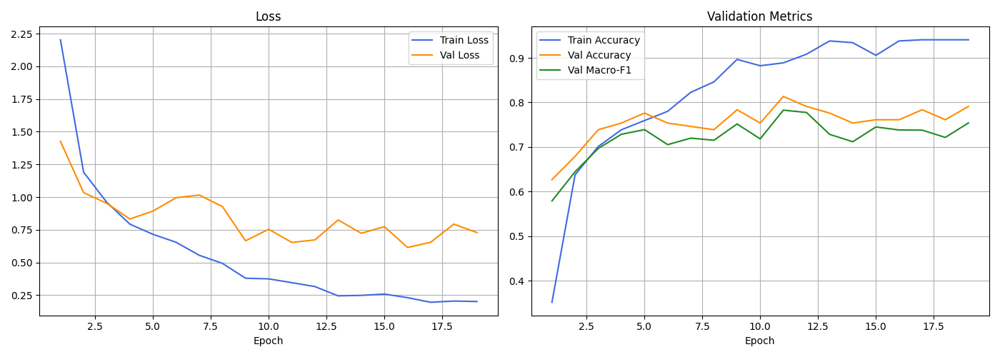
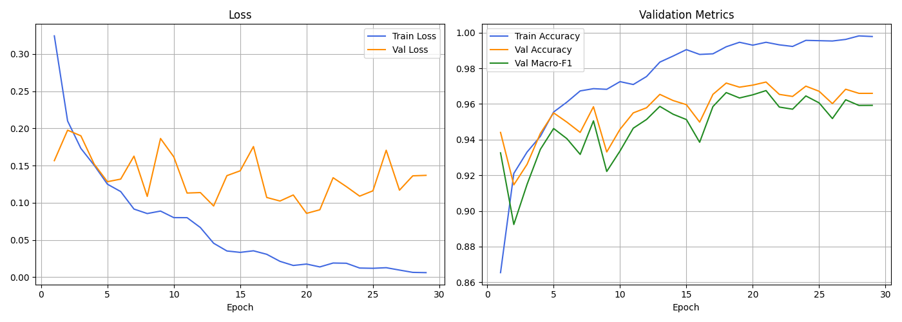
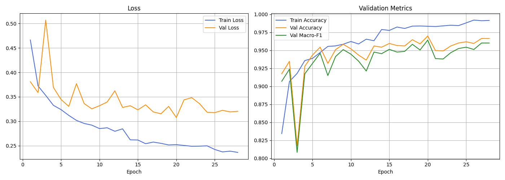
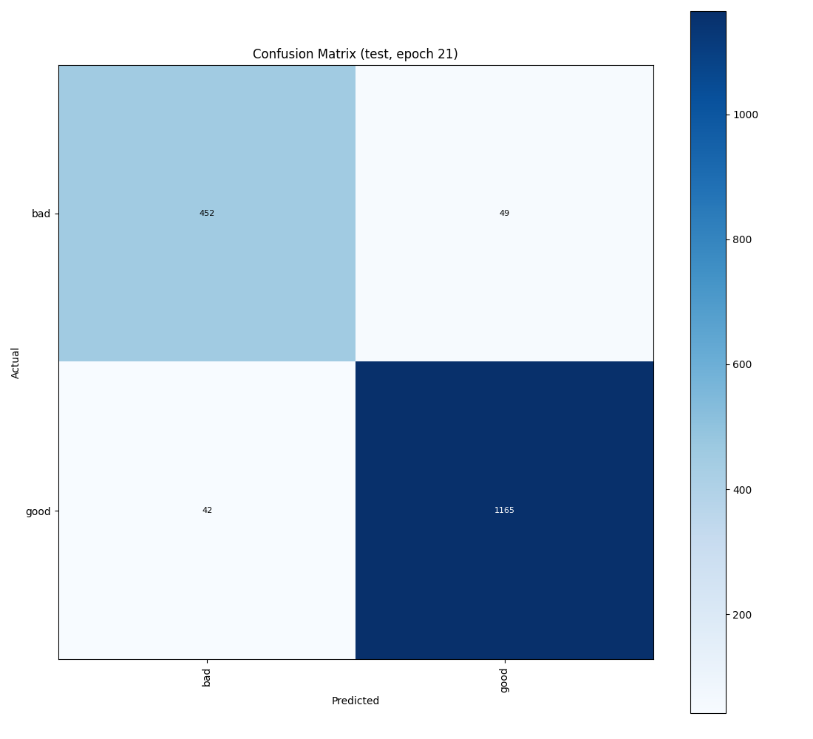
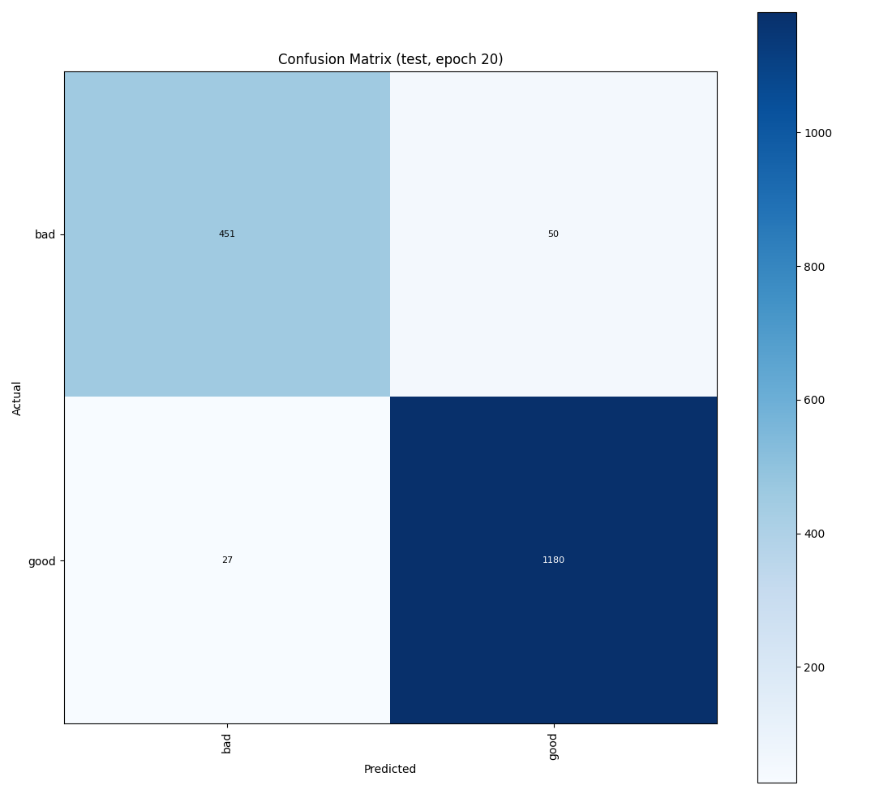
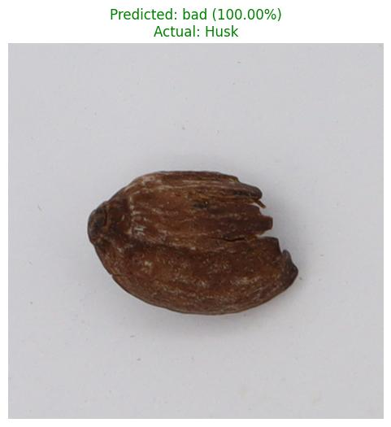
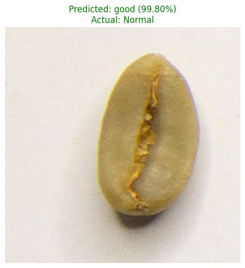
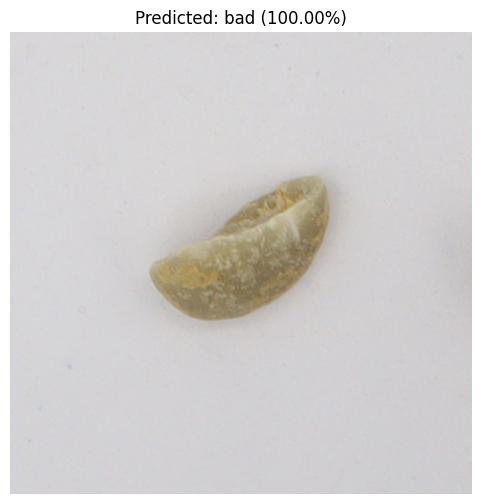

# 📓 週工作日誌｜咖啡豆缺陷辨識（2026/09/24 – 09/30）

> **一句話總結**：從「18 類缺陷分類」轉向「好豆 / 壞豆二分類」，合併 USK-Coffee 資料集（train 5573 / val 1734 / test 1708），加入正則化後測試 accuracy 由 **94.7% → 95.5%**、macro-F1 由 **0.936 → 0.945**。

---

## 1. 本週目標與結果

| 目標 | 狀態 |
|---|---|
| 擴充資料（併入 USK-Coffee、自拍豆） | ✅ 完成 |
| 離線資料擴增（只擴增 train，避免洩漏） | ✅ 完成 |
| 改為好豆 / 壞豆二分類 | ✅ 完成 |
| 比較 ResNet18 / ResNet50 / EfficientNet-B0 | ✅ 完成 |
| 降低 overfitting（Dropout、weight decay、label smoothing） | ✅ 完成，見第 4 節 |
| 統一「好壞」標準（偏黃、銀皮斑塊） | ⏳ 未決定，列入下週 |

---

## 2. 資料處理

- `augment.py`：只對 **train** 做離線擴增（翻轉、旋轉、裁切、亮度/對比、模糊、雜訊），每類補到目標張數；val / test 不動。
- `merge_classes.py`：把相近類別合併（Full/Partial Black → Black、Full/Partial Sour → Sour、Slight/Severe Insect → Insect Damage）。
- `resize_class.py`：處理 Normal 類別 200×200 與其他 500×500 解析度不一致的問題。
- `make_binary_split.py`：依人工標註 `binary_labels.csv` 產生 bad / good 切分檔，USK-Coffee 沿用其原 train/val/test。

| 切分 | good | bad | 合計 |
|---|---|---|---|
| train | 3626 | 1947 | 5573 |
| val | 1199 | 535 | 1734 |
| test | 1207 | 501 | 1708 |

### 程式碼：二分類切分（`make_binary_split.py` 節錄）

```python
CLASSES = ["bad", "good"]

for name, items in usk.items():  # USK-Coffee 沿用它自己的 train/val/test
    splits[name] += items

rng = random.Random(seed)
rng.shuffle(extra)
n_val, n_test = round(len(extra) * val_ratio), round(len(extra) * test_ratio)
splits["val"]   += [list(x) for x in extra[:n_val]]
splits["test"]  += [list(x) for x in extra[n_val:n_val + n_test]]
splits["train"] += [list(x) for x in extra[n_val + n_test:]]
```

---

## 3. 模型與訓練程式碼修改

### 3.1 `model.py`：支援多種 backbone + Dropout

```python
def __init__(self, num_classes=18, pretrained=True, arch="resnet18", dropout=0.0):
    ...
    weights = "DEFAULT" if pretrained else None
    if arch == "efficientnet_b0":
        net = models.efficientnet_b0(weights=weights)
        self.backbone = nn.Sequential(net.features, net.avgpool)
        feat_dim = net.classifier[1].in_features
    else:  # resnet18 / resnet50 ...
        net = getattr(models, arch)(weights=weights)
        self.backbone = nn.Sequential(*list(net.children())[:-1])
        feat_dim = net.fc.in_features

    self.dropout = nn.Dropout(dropout)          # 訓練時隨機丟特徵，抑制 overfitting
    self.classifier = nn.Linear(feat_dim, num_classes)
```

### 3.2 `train.py`：新增正則化參數

```python
parser.add_argument("--arch", default="resnet50", choices=["resnet18", "resnet50", "efficientnet_b0"])
parser.add_argument("--dropout", type=float, default=0.5)
parser.add_argument("--weight-decay", type=float, default=0.05)
parser.add_argument("--label-smoothing", type=float, default=0.1)

criterion = nn.CrossEntropyLoss(weight=class_weights, label_smoothing=args.label_smoothing)
optimizer = optim.AdamW(model.parameters(), lr=args.lr, weight_decay=args.weight_decay)
```

### 3.3 `dataset.py`：更強的線上資料增強

```python
transforms.RandomResizedCrop(image_size, scale=(0.6, 1.0), ratio=(0.85, 1.15)),
transforms.RandomHorizontalFlip(),
transforms.RandomVerticalFlip(),
transforms.RandomRotation(degrees=30),
transforms.ColorJitter(brightness=0.3, contrast=0.3, saturation=0.2, hue=0.05),
transforms.ToTensor(),
transforms.Normalize(mean=IMAGENET_MEAN, std=IMAGENET_STD),
transforms.RandomErasing(p=0.25, scale=(0.02, 0.15), value="random"),  # 遮住一小塊
```

### 3.4 `batch_predict.py`：支援二元模型與每類抽樣

```python
parser.add_argument("--per-class", type=int, default=None,
                    help="Sample N images from every class folder (overrides --num-images)")

# 二元模型（bad/good）：Normal 資料夾算 good，其餘瑕疵類別都算 bad
binary = set(predictor.class_names) == {"bad", "good"}
expected = ("good" if actual == "Normal" else "bad") if binary else actual
```

---

## 4. 實驗結果比較

| 實驗 (`runs/…`) | 設定 | Val Acc | Val F1 | **Test Acc** | **Test F1** |
|---|---|---|---|---|---|
| `20260923-201308` | 18 類 ResNet18（起點） | 0.813 | 0.783 | 0.611 | 0.570 |
| `merged_fixed` | 好/壞 ResNet18 | 0.960 | 0.952 | 0.932 | 0.916 |
| `merged_efficientnet_b0` | 好/壞 EfficientNet-B0 | 0.959 | 0.952 | 0.932 | 0.917 |
| `merged_resnet50` | 好/壞 ResNet50 | 0.971 | 0.966 | 0.948 | 0.935 |
| `merged_resnet50_v2` | 好/壞 ResNet50（調整版） | 0.972 | 0.968 | 0.947 | 0.936 |
| **`bin_reg`** | **ResNet50 + Dropout 0.5 + WD 0.05 + LS 0.1** | 0.970 | 0.964 | **0.955** | **0.945** |

**觀察**
- 18 類 → 二分類後 test 從 61% 大幅提升（但任務本身變簡單，兩者不能直接比較）。
- ResNet50 明顯優於 ResNet18 / EfficientNet-B0。
- 加入正則化後 test 再進步約 0.8 個百分點，且 **bad 類 recall 從 0.90 維持、good 類 FN 由 42 降到 27**。

---

## 5. 訓練圖

### 5.1 起點：18 類 ResNet18（9/23）


### 5.2 ResNet50 二分類（`merged_resnet50_v2`）
Train loss 降到 ~0.005，Val loss 在 0.09–0.17 震盪 → 有 overfitting 跡象。


### 5.3 加入正則化（`bin_reg`）
Train loss 停在 ~0.24（label smoothing 的下限），Val loss 更平穩，訓練 / 驗證差距縮小。


---

## 6. 測試圖

### 6.1 混淆矩陣（test set）

**`merged_resnet50_v2`**（bad→good 誤判 49、good→bad 誤判 42）


**`bin_reg`**（bad→good 誤判 50、good→bad 誤判 27）


`bin_reg` 測試集報告：

| class | precision | recall | F1 | support |
|---|---|---|---|---|
| bad | 0.9435 | 0.9002 | 0.9213 | 501 |
| good | 0.9593 | 0.9776 | 0.9684 | 1207 |

### 6.2 單張預測（`batch_predict.py`）
| Husk（瑕疵）→ bad 100% | USK 樣本 | 二元模型輸出 |
|---|---|---|
|  |  |  |

---

## 7. 遇到的問題

- **Normal 圖片解析度（200×200）與其他類（500×500）不同**：可能被模型當成捷徑，已用 `resize_class.py` 處理。
- **標籤矛盾**：`Fade_08.jpg` 與 `Partial Sour_06.jpg` 是同一張圖，切分時已排除。
- **好壞標準不一致**：偏黃算不算壞未決定（影響 USK 約 60 張漏抓）；銀皮斑塊算壞豆只套用在自拍資料。
- **bad recall 只有 0.90**：漏抓壞豆（bad→good 50 張）是實務上比較嚴重的錯誤。

---

## 8. 下週計劃

- [ ] 補拍自己的好豆與壞豆（目前自拍好豆只剩 35 張），裁成單顆 500×500 併入 `data/merged/`
- [ ] 統一好壞標準，並依新標準複查 USK 好豆
- [ ] 用新資料重訓 ResNet50，分開評估自拍與 USK 的好 / 壞豆表現
- [ ] 調整決策門檻，提高 bad recall
