# 專題週誌｜咖啡豆分選機（2026/10/08 – 10/14）

> 📅 記錄日期：2026/10/14（二）
> ✍️ 記錄人：吳泰羲

---

## 一、本週目標

- [x] 建置**日曬豆（Natural）**與**蜜處理豆（Honey）**影像資料集
- [x] 日曬、蜜處理比照水洗豆流程切分資料，並各自訓練模型
- [x] 模型輸出每顆被評為壞豆的**信心度**
- [x] 每次訓練結束後，自動列出所有**被誤判或漏抓**的照片

## 二、本週完成事項

### 1. 日曬豆、蜜處理豆資料集建置完成

- 沿用水洗豆的流程：**逐顆人工挑選**、**單顆單獨拍攝**，標籤由資料夾名稱取得
- 兩個資料集皆於 10/14 當天拍攝，與水洗豆維持相同的 `處理法/good`、`處理法/bad` 結構

| 處理法 | good | bad | 合計 | good : bad |
| --- | --- | --- | --- | --- |
| 水洗 `water`（上週） | 680 | 666 | 1,346 | 1.02 : 1 |
| 日曬 `sun` | 509 | 506 | **1,015** | 1.01 : 1 |
| 蜜處理 `honey` | 509 | 503 | **1,012** | 1.01 : 1 |

- 三個資料集的 good / bad 比例都接近 1 : 1，不需處理類別不均
- 目前三種處理法共 **3,373 張**

### 2. 日曬、蜜處理資料前處理與切分

- 直接沿用 `prepare_dataset.py`：偵測豆子位置並裁成 256×256 方形小圖，再以「類別 × 拍攝日期」分層抽樣切成 70 / 15 / 15（seed = 42）
- 切分結果存成 `splits/sun.json`、`splits/honey.json`（進版本控制，可重現）

| 處理法 | train | val | test | test 中 bad / good |
| --- | --- | --- | --- | --- |
| 日曬 | 711 | 152 | 152 | 76 / 76 |
| 蜜處理 | 710 | 151 | 151 | 75 / 76 |

- 注意：這兩批資料都只在 10/14 一天拍完，「按拍攝日期分層」在這裡等於只分了類別，無法像水洗豆一樣驗證跨日期的穩定度（見檢討）

### 3. 新增功能：壞豆信心度

- 信心度 `p_bad` = 模型認為該顆是壞豆的機率（0 ~ 1），**不論最後判成好或壞都會給**
- `predict.py` 每張照片都會印出「bad 信心度」，輸出的標註圖標題也多一行信心度
- `Predictor.predict()` 回傳值改為 `(判定類別, 判定機率, p_bad)`
- 用途：可自訂門檻（例如 `p_bad > 0.3` 就當壞豆）來**減少漏抓**；也能把信心度落在中間區段（0.3 ~ 0.7）的豆子交給人工複檢

```python
# predict.py — Predictor.predict()
bad_idx = self.class_names.index("bad")
probs = torch.softmax(self.model(x), dim=1)
scores, indices = probs.max(dim=1)
results += [(self.class_names[i], s, b)
            for i, s, b in zip(indices.tolist(), scores.tolist(), probs[:, bad_idx].tolist())]
# 回傳 (判定類別, 判定機率, p_bad)
```

### 4. 新增功能：每次訓練後自動列出誤判／漏抓照片

`train.py` 訓練結束後，會對 val 與 test 逐張預測，並在 `runs/<method>/<時間戳>/` 產生：

| 檔案 | 內容 |
| --- | --- |
| `predictions_val.csv`、`predictions_test.csv` | 每張的實際類別、預測類別、`p_bad` |
| `errors_val.txt`、`errors_test.txt` | 所有判錯的照片，分成**漏抓**（壞豆判成好豆）與**誤判**（好豆判成壞豆），依離譜程度排序 |
| `errors/<split>/missed/`、`false_alarm/` | 把判錯的照片複製出來，檔名開頭是 `p_bad`，可直接檢視 |

- 終端機輸出也會直接列出 test 的錯誤清單
- 漏抓比誤判更嚴重（壞豆會混進成品），所以分開列出

```python
# train.py — analyze_errors()（節錄）
for (path, label), p in zip(samples, probs):
    pred = int(p.argmax())
    p_bad = float(p[bad_idx])
    writer.writerow([Path(path).name, class_names[label], class_names[pred], f"{p_bad:.4f}", int(pred == label)])
    if pred != label:
        (missed if label == bad_idx else false_alarm).append((path, p_bad))
missed.sort(key=lambda r: r[1])        # 漏抓：p_bad 越低越離譜
false_alarm.sort(key=lambda r: -r[1])  # 誤判：p_bad 越高越離譜
```

### 5. 日曬、蜜處理模型訓練結果

- 設定：ResNet18（ImageNet 預訓練）、Dropout 0.5、weight decay 0.05、label smoothing 0.1、類別權重，與水洗豆相同；各自獨立訓練、各自存模型
- 測試集只在訓練結束後評估一次

訓練核心設定（`train.py`，三種處理法相同）：

```python
model = CoffeeBeanClassifier(num_classes=2, arch="resnet18", dropout=0.5)   # ImageNet 預訓練
criterion = nn.CrossEntropyLoss(weight=class_weights, label_smoothing=0.1)  # 類別權重 + 標籤平滑
optimizer = optim.AdamW(model.parameters(), lr=1e-4, weight_decay=0.05)
scheduler = optim.lr_scheduler.ReduceLROnPlateau(optimizer, mode="min", factor=0.5, patience=3)
# epochs=30, batch_size=16, img_size=224, early stopping patience=8, seed=42
# 以驗證集 macro-F1 挑最佳權重（同分取 val loss 較低者）
```

資料增強（`dataset.py`，只用在訓練集）：

```python
transforms.RandomResizedCrop(224, scale=(0.6, 1.0), ratio=(0.85, 1.15)),
transforms.RandomHorizontalFlip(),
transforms.RandomVerticalFlip(),
transforms.RandomRotation(degrees=30),
transforms.ColorJitter(brightness=0.3, contrast=0.3, saturation=0.2, hue=0.05),
transforms.ToTensor(),
transforms.Normalize(mean=IMAGENET_MEAN, std=IMAGENET_STD),
transforms.RandomErasing(p=0.25, scale=(0.02, 0.15), value="random"),
```

| 處理法 | 最佳 epoch | val macro-F1 | test 準確率 | test macro-F1 | test 判錯 |
| --- | --- | --- | --- | --- | --- |
| 日曬 | 19 | 1.000 | **99.3%** | 0.993 | 漏抓 1、誤判 0 |
| 蜜處理 | 21 | 1.000 | **99.3%** | 0.993 | 漏抓 1、誤判 0 |

- 日曬：bad recall 0.987、good recall 1.000；唯一判錯的是 `P_20261014_164140.jpg`（壞豆，p_bad = 0.267）
- 蜜處理：唯一判錯的是 `P_20261014_135247.jpg`（壞豆，p_bad = 0.405）
**訓練曲線（左：Loss，右：驗證指標）**

日曬：

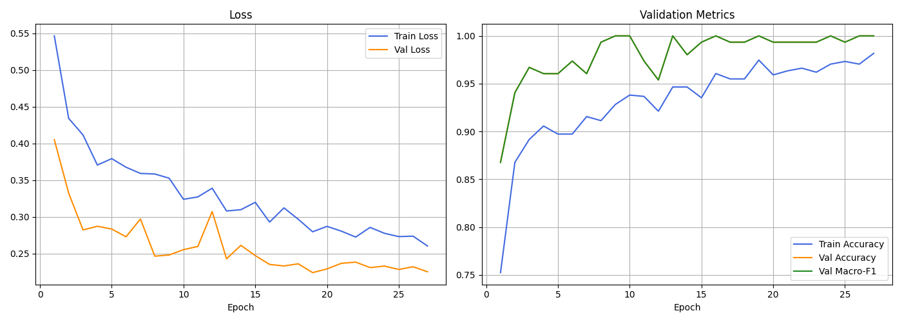

蜜處理：

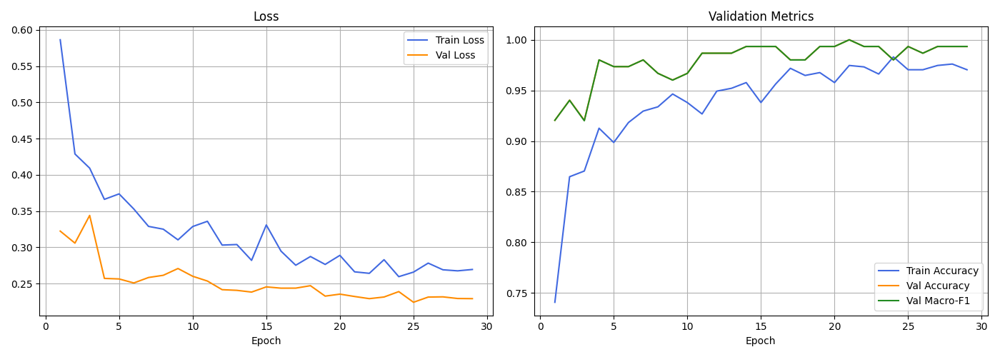

**測試集混淆矩陣**

日曬：


蜜處理：

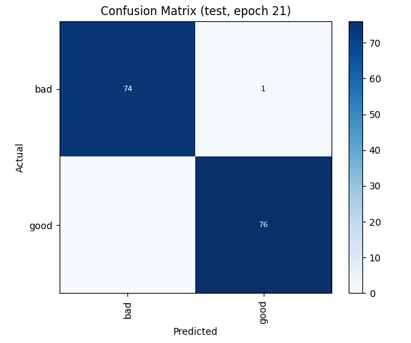

- 兩者的錯誤都是**壞豆漏抓**，且 p_bad 落在 0.3 ~ 0.4，若把門檻降到 0.25 ~ 0.3 附近就有機會抓回（需再用驗證集確認，避免誤判變多）

### 6. 水洗豆重新訓練（含錯誤分析）

- 為了產出誤判／漏抓清單，用新版程式重訓水洗豆（ResNet18，最佳 epoch 10）
- test 準確率 **97.0%**，macro-F1 0.970，202 張判錯 6 張

| 類型 | 張數 | 照片（p_bad） |
| --- | --- | --- |
| 漏抓（bad → good） | 5 | `P_20261007_205845`（0.089）、`P_20261007_210823`（0.119）、`P_20261008_151908`（0.417）、`P_20261008_145418`（0.453）、`P_20261007_205655`（0.490） |
| 誤判（good → bad） | 1 | `P_20261008_154404`（0.768） |

**訓練曲線與測試集混淆矩陣**

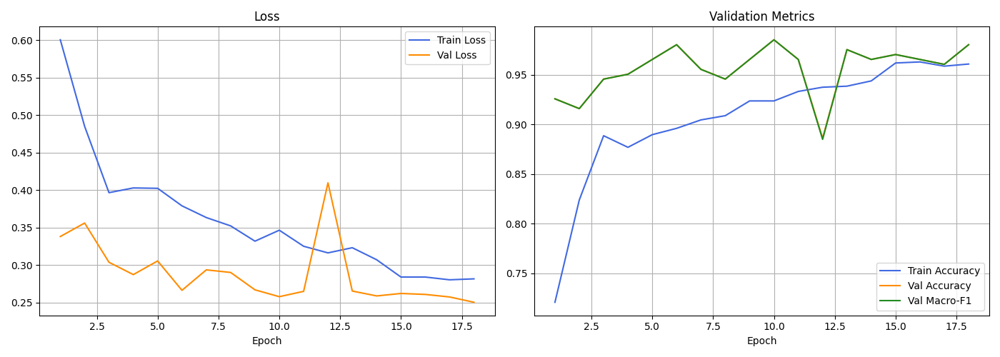

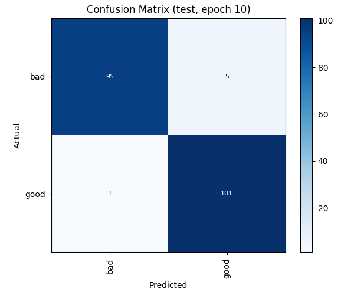

**被判錯的照片（test 集，依 p_bad 排序）**

| 處理法 | 類型 | p_bad | 檔名 | 照片 |
| --- | --- | --- | --- | --- |
| 水洗 | 漏抓（bad → good） | 0.089 | `P_20261007_205845.jpg` | 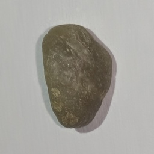 |
| 水洗 | 漏抓（bad → good） | 0.119 | `P_20261007_210823.jpg` | 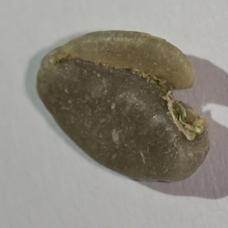 |
| 水洗 | 漏抓（bad → good） | 0.417 | `P_20261008_151908.jpg` | 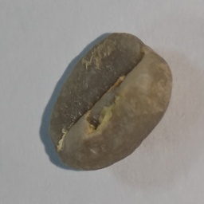 |
| 水洗 | 漏抓（bad → good） | 0.453 | `P_20261008_145418.jpg` | 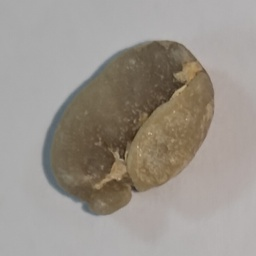 |
| 水洗 | 漏抓（bad → good） | 0.490 | `P_20261007_205655.jpg` | 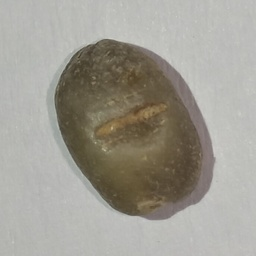 |
| 水洗 | 誤判（good → bad） | 0.768 | `P_20261008_154404.jpg` | 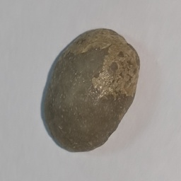 |
| 日曬 | 漏抓（bad → good） | 0.267 | `P_20261014_164140.jpg` | 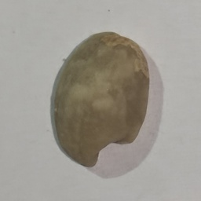 |
| 蜜處理 | 漏抓（bad → good） | 0.405 | `P_20261014_135247.jpg` | 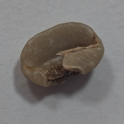 |

- 漏抓的壞豆 p_bad 越低，代表模型越「理直氣壯地錯」；水洗的 0.089、0.119 兩張最值得優先人工複查

- 其中 `205845`、`210823` 兩張 p_bad 不到 0.12，是模型很有把握卻判錯，值得優先回頭檢查是**標籤錯誤**還是瑕疵本身不明顯
- 與 10/08 的版本（97.5%）相差 0.5 個百分點，約 1 張的差距，屬隨機波動範圍

### 7. 三種處理法比較

| 處理法 | 資料量 | test 準確率 | test 判錯（漏抓 / 誤判） |
| --- | --- | --- | --- |
| 水洗 | 1,346 | 97.0% | 5 / 1 |
| 日曬 | 1,015 | 99.3% | 1 / 0 |
| 蜜處理 | 1,012 | 99.3% | 1 / 0 |

- 日曬、蜜處理反而比水洗更準，可能原因：①這兩批只在單一天、單一條件下拍攝，train 與 test 的條件幾乎相同；②瑕疵與好豆在外觀上差異更明顯。**不宜直接解讀為這兩種豆比較好分**，見下方檢討

### 8. 程式與文件更新

- `train.py`、`predict.py`、`README.md` 已更新並 commit（`f089877`）
- README 新增日曬／蜜處理結果表與「壞豆信心度與錯誤清單」說明

## 三、遇到的問題與檢討

- **日曬、蜜處理僅單日拍攝**：兩批資料全在 10/14 拍完，無法檢查跨日期的光線、擺放差異，99.3% 可能偏樂觀。建議之後另找一天補拍一小批（各約 100 張）當**獨立驗證集**，才能判斷真實表現
- **同一顆豆若連拍多張**，可能同時落在 train 與 test 造成分數偏高；目前一張對應一顆，但檔名沒有豆子編號，無法事後驗證
- **test 集僅約 150 ~ 200 張**，錯 1 張就差約 0.5 ~ 0.7 個百分點，三個模型的差距在統計上不顯著
- **尚未檢查模型是否靠背景、拍攝時間等非豆子特徵判斷**：可用 Grad-CAM 看模型注意的位置
- **`bad` 仍是單一類別**，尚未細分瑕疵種類，需向指導老師確認
- **文件不一致待釐清**：10/08 週誌寫「預設 backbone 改為 ResNet50」，但目前 `train.py` 預設是 ResNet18，`runs/water/` 底下的 config 也都是 ResNet18，需確認當時結果實際用的是哪個架構，並修正週誌或程式

## 四、下週進度規劃（2026/10/15 – 10/21）

- [ ] **檢查水洗豆高信心度錯誤**：人工確認 `P_20261007_205845`、`P_20261007_210823` 等標籤是否正確
- [ ] **補拍獨立驗證集**：日曬、蜜處理各約 100 張，不同日期／光線，驗證泛化能力
- [ ] **調整判定門檻**：用驗證集的 `p_bad` 分佈找出能降低漏抓、又不讓誤判暴增的門檻，並畫 ROC / PR 曲線
- [ ] **模型可解釋性**：Grad-CAM 檢查模型是否真的看豆子的瑕疵位置
- [ ] **架構比較**：在三種處理法上比較 ResNet18 / ResNet50 / EfficientNet-B0，並釐清上述週誌與設定不一致的問題
- [ ] **評估整合方式**：是否需要一個能自動判斷處理法的前置模型，或由使用者手動選擇；以及部署到 Jetson Nano 的推論速度評估

## 五、備註

- 三種處理法的資料集與模型皆已完成第一版：`models/water`、`models/sun`、`models/honey`，使用 `python predict.py --method <water|sun|honey> --image 照片` 即可切換
- 每次訓練的完整紀錄（曲線、混淆矩陣、錯誤清單）都在 `runs/<method>/<時間戳>/`
